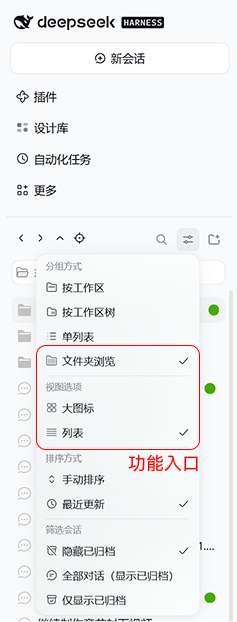
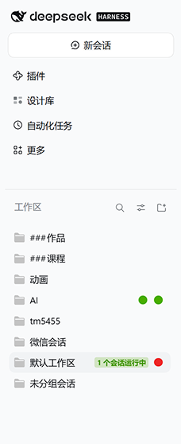
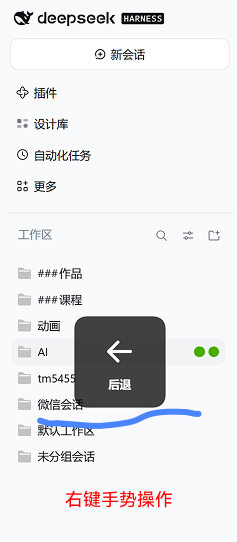
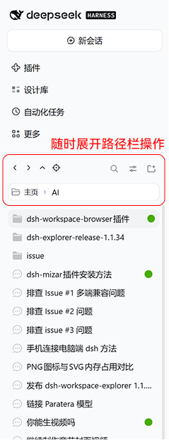
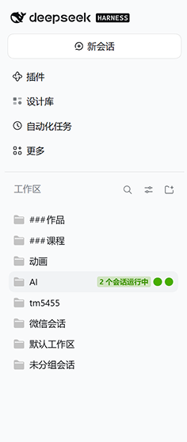
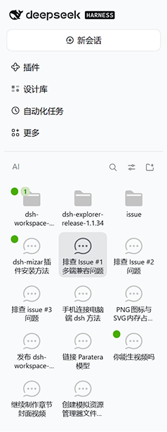

# 工作区浏览器 · Workspace Browser

`dsh-workspace-browser` 为 DeepSeek Harness 的工作区与会话提供文件资源管理器式的浏览页面。

## 安装试用

在 DSH 的「插件 → 添加插件」中粘贴安装包的本地完整路径。启用后，打开左侧「工作区」标题旁的「视图选项」，在「分组方式」下选择「文件夹浏览」。

## 浏览工作区

- 「主页」是工作区树的根，列出顶层工作区。有未归属会话时，主页也会显示「未分组会话」。
- 工作区层级沿用 DSH「按工作区树」的规则。双击文件夹进入，单击会话打开原对话。也可以用 Tab 聚焦，按 Enter 打开。
- 标题显示当前文件夹名，根目录显示「工作区」。将鼠标移到标题区即可展开路径栏，点击路径或使用旁边的按钮返回其他层级。
- 下方网格和列表可独立滚动。
- 会话右侧显示状态点，文件夹汇总下属会话的状态。在子目录里，标题左侧提示当前目录之外最高优先级的状态。
- 文件夹浏览及当前目录会保存在 DSH 客户端。切换会话时侧栏保持文件夹视图。
- 可拖动路径栏上方的横线调整分区比例。双击横线恢复默认。
- 「文件夹浏览」启用时，可在同一菜单切换「大图标」和「列表」。
- 文件夹浏览支持从左侧栏任意位置开始的右键手势。按住右键向左后退、向右前进、向上返回上一级，松手时执行。单击右键保留原来的菜单行为。
- 排序和归档筛选沿用「视图选项」中的设置。搜索时显示 DSH 原生搜索结果，清空后回到当前目录。

## 截图

<table>
  <tr>
    <td></td>
    <td></td>
    <td></td>
    <td></td>
  </tr>
  <tr>
    <td></td>
    <td></td>
    <td></td>
    <td></td>
  </tr>
</table>

## 本地构建

在源码目录运行 `npm pack`，即可生成 `.tgz`。插件使用 DSH 提供的界面组件和主题，构建无需安装依赖。
